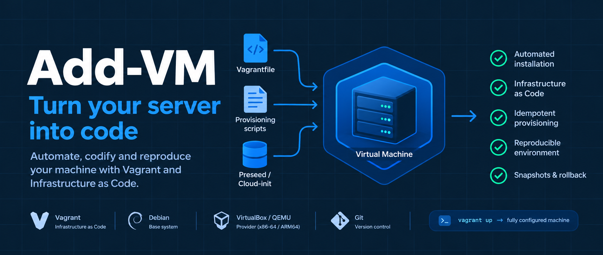

# Overview of this project

## What we should learn

This project is about 3 important ideas: Infrastructure as Code (IaC), Idempotency, and Proving reproducibility. Together they answer one question: how do we automate the installation and configuration of a VM so that anyone can rebuild it?

- **Infrastructure as Code (IaC):** the whole idea of the project. The server is described in files kept in git and built by a program, not by a person clicking. If a setting is not in the repository, it does not exist.
- **Idempotency:** running the provisioning twice leaves the machine in the same state as running it once, with no errors and nothing duplicated.
- **Proving reproducibility:** we destroy the VM and rebuild it from code, then run `verify.sh` to check that everything we built before still works.

## Build Steps
```
1. preseed/preseed.cfg    Installs the OS unattended, including the LVM partitioning

2. provision/linux.sh     Configures what the installer doesn't: static IP, systemd service, LV extend

3. provision/login.sh     Applies your login policy: users, sudoers, PAM, ACLs, SSH

4. verify.sh              Proves the policy holds (from login, unchanged)

5. Vagrantfile            Ties everything together: which box, which scripts, vagrant up
```

### 1. Configuring `preseed.cfg`

I started with an expert installation of Debian. For each question I encountered during the installation, I researched the corresponding preseed directive and how to use it to automate that step. I then added the necessary directives to `preseed.cfg` until the installation process could run unattended, including the LVM partitioning.